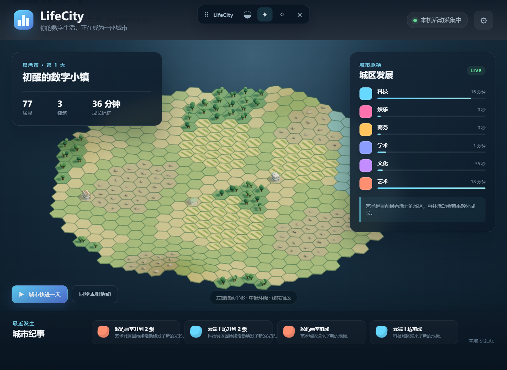
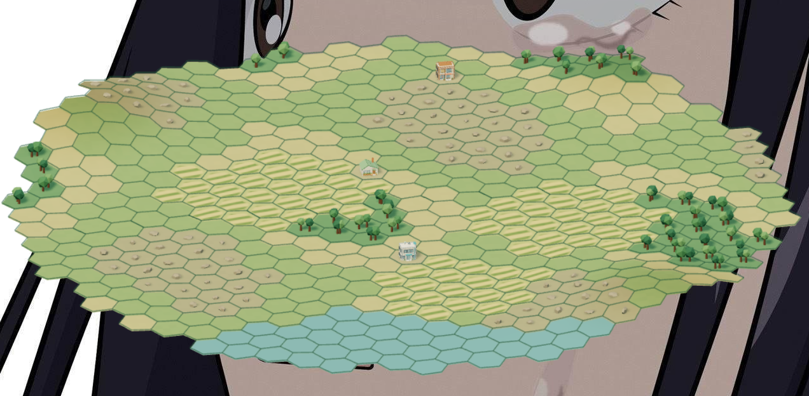
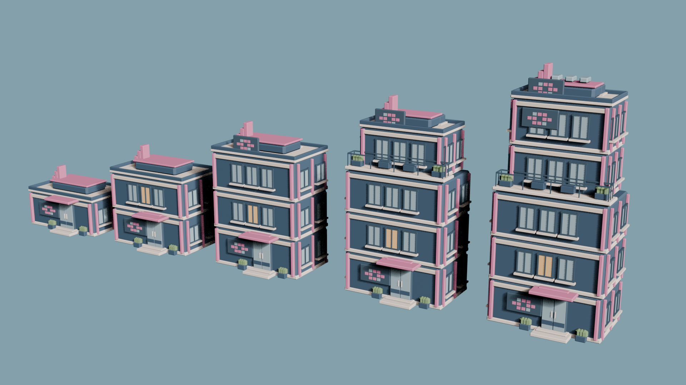

# LifeCity

LifeCity 是一个 Windows 桌面小程序。它记录当前使用的应用，把开发、学习、游戏、创作等活动变成不同城区的成长。比如使用blender等软件，艺术类模块建筑就会增长；使用steam等，娱乐模块建筑就会增长。

城市由六边形地块组成，可以拖动、缩放，也可以点开建筑看看它的等级。



关闭窗口后程序会留在托盘，继续记录活动；从托盘选择“退出”才会停止。想先看看效果，可以点“城市快进一天”。





## 运行

需要 Node.js、Rust 和 Windows 上的 Tauri 开发环境。在项目目录执行：

```powershell
npm install
npm run tauri dev
```

浏览器预览用 `npm run dev`，此模式只有演示数据。

## 打包 Windows 安装包

在 Windows 上运行：

```powershell
npm run tauri build
```

构建完成后，安装包在 `src-tauri/target/release/bundle/nsis/`，文件名类似 `LifeCity_0.1.0_x64-setup.exe`。双击即可安装。

## 数据与素材

活动采集在本机完成，窗口标题只用于当下的分类，不写入城市存档；城市数据保存在本机 SQLite。设置中可以修改分类规则，也可以备份并重置城市。

建筑模型放在 `public/models/buildings/`，并在 `public/models/catalog.json` 登记。没有配置模型时会使用内置造型。
